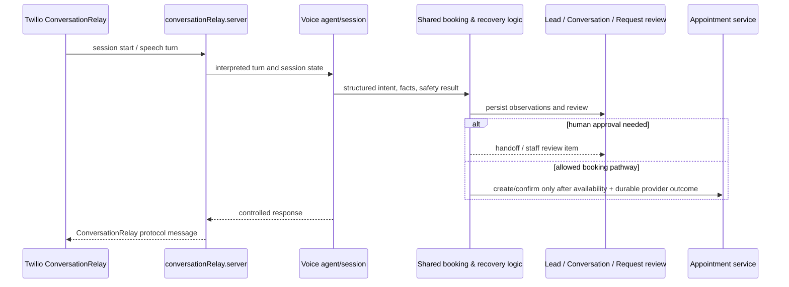

# MeekCall — Current customer-request architecture (Phase 0 working map)

**Reference commit:** `e51679e1d65e851dda31806604b7cf649fb7f0fe` (API main/development, inspected 2026-11-05).

**Scope:** This is the evidence-backed initial map of the high-risk paths. It is **not** the exhaustive file:line write inventory or an accepted authoritative design. Before using it for state migration, expand it with a whole-repo reference search and real integration traces.

## Ownership and boundaries observed

| Concern | Existing representation | Current writer/reader examples | Contention requiring a decision |
|---|---|---|---|
| Lead facts / preference | Lead and `Conversation.conversationMemory` | `src/services/booking/recoveryIntake.service.js` (lines 97–127 and 170–217); `src/services/recoveryCoordinator/recoveryCoordinator.service.js` (approx. 75–92) | Old intake can update the same lead facts; coordinator checks `updatedAt` version on opt-in writes |
| Customer dialogue state | `Conversation.bookingState` and memory | `bookingStateMachine.service.js`, `recoveryIntake.service.js`, `inboundSmsJobProcessor.service.js` | State names and policy decisions are distributed over these files |
| Staff review/work item | `Alert`/intervention records | `src/services/businessRequestWorkflow.service.js` (aggregation, approval, outcome); `src/services/recoveryCoordinator/recoveryScope.repository.js` (tenant + assigned review) | Different review and recovery records exist; consolidating legacy alerts is distinct from booking |
| Recovery decision | `RecoveryCase`, `RecoveryEvent` | `src/services/recoveryCoordinator/recoveryCoordinator.service.js` | Feature-flagged and pilot-scoped; accepted service ≠ confirmed booking |
| Slot hold and booking truth | `Appointment` | `src/services/scheduling/appointment.service.js`, `src/services/scheduling/commands/confirm-1.js` | An appointment's durable `confirmed` state is booking authority; coordinator only observes it |
| Reminder / notification state | `AppointmentNotificationJob` | `appointmentNotification.service.js` and background worker | Provider send, provider acknowledgement, and delivery status are separate facts |
| Read models / metrics | Lead, conversation, alert, appointment, conversion records | `appointmentProjection.service.js`, `businessRequestWorkflow.service.js` | Projections can lag; never derive booking truth from UI badge alone |

## High-value state terms observed (non-exhaustive)

- Appointment: `held`, `confirmed`, `failed`, `canceled`, `completed`, `no_show`, `rescheduled`. Source: `src/models/appointment.js`.
- Recovery coordinator: `qualifying`, `needs_review`, `accepted`, `declined`, `scheduling`, `booked`, `closed` appear in coordinator read/write/reconcile and contract logic. **Verify complete enum in** `src/models/recoveryCase.js` and `src/services/recoveryCoordinator/contract.js` before codifying any transition table.
- Booking conversation: `offering_slots`, `awaiting_confirmation`, `booking`, `pending_business_confirmation`, `booked`, `human_takeover`, among other states. Source: `recoveryIntake.service.js` (booking-active set near line 104); do not assume this is the complete state machine.
- Human request/review and operational alert status are distinct from appointment booking status; `booked` in one UI projection must not override `Appointment.status`.

## Missed-call → SMS → appointment: illustrative sequence of observed components

```mermaid
sequenceDiagram
    participant Twilio as Twilio webhook
    participant Webhook as Ingress/controller
    participant Queue as Durable SMS worker
    participant Intake as SMS processor + recovery intake
    participant State as Lead / Conversation / Alert
    participant Staff as Staff review UI + API
    participant Book as Appointment service
    participant Provider as Internal/External scheduling
    participant Notify as Notification jobs
    Twilio->>Webhook: missed call / customer event
    Webhook->>Queue: idempotent durable work
    Queue->>Intake: customer turn
    Intake->>State: save facts, workflow and review evidence
    Intake-->>Twilio: SMS response (subject to consent/STOP rules)
    Staff->>State: review, staff decision, approval
    Staff->>Book: create/confirm with idempotency key
    Book->>Provider: validate & create booking
    Provider-->>Book: external outcome
    Book->>State: persist Appointment.status=confirmed
    Book->>Notify: schedule reminders; failure must not undo confirmed
    Book-->>Staff: appointment result / review status
```

This diagram is a topology sketch, **not a certified exhaustive order of every Twilio callback**, and it does not claim that staff always approve a fully captured request automatically.

## Voice → request → booking (high-level)



Before altering protocol transport, snapshot exact outbound message bytes, timeout semantics, turn interruption, STOP/human takeover behavior, and error-frame behavior in golden contract tests.

## Source locations to inspect before building a canonical authority

- `src/services/booking/bookingStateMachine.service.js` — customer intent/booking state mutations, extensive dependencies.
- `src/services/booking/recoveryIntake.service.js` — fact capture and industry-specific handling (e.g. `isUrgentPlumbingRequest`, lines ~145–260).
- `src/services/messaging/inboundSmsJobProcessor.service.js` — SMS turn coordination and persistence.
- `src/services/businessRequestWorkflow.service.js` — review aggregation and updates.
- `src/services/recoveryCoordinator/recoveryCoordinator.service.js` — pilot versioned review and decisions.
- `src/services/recoveryCoordinator/reconciliation.service.js` — evidence-only observation of confirmed Appointment.
- `src/services/scheduling/commands/confirm-1.js` — provider call + durable confirmation + secondary effects.
- `src/services/scheduling/appointmentProjection.service.js` — pending projection markers and idempotent repair.
- `src/voice/conversationRelay.server.js` — wire protocol/session control; must be characterized before splitting.

## Known architecture constraints to preserve

- Existing API routes, response shapes, billing and trial behavior, SMS/voice wording, sockets, feature flags and defaults must remain unchanged during extraction.
- Never turn a provider acknowledgement into customer confirmation before durable provider and database state.
- Never infer cross-tenant ownership from a client-provided `businessId` alone.
- Keep deterministic emergency bypass before NLU/LLM/industry selection.
- Shadow mode must not send communications, book visits, or mutate canonical legacy records.

## Evidence gaps for full Phase 0

1. Search *all* request-state writers and document each in a line-referenced inventory.
2. Enumerate model enum values and transition conditions from the current code, not an inferred lifecycle diagram.
3. Run local Mongo replica-set and full Jest suites three times; record coverage per directory, timing, flaky tests.
4. Record exact Twilio, OAuth, Google and Stripe side-effect boundaries from controlled mocks; no production/staging calls.
5. Record a live browser pass on exact tested commits after owner configures cross-repo checkout.
