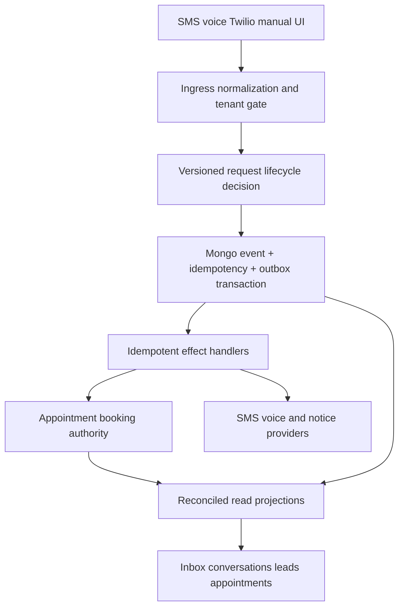

# Target state — MeekCall (architectural north star, NOT implemented)

**Status:** proposed design reference for Phases 2–8; implementation and certification are outstanding.

## Domain ownership

- A versioned `RequestLifecycle` owns request facts and staff eligibility decisions. One change produces one committed transition and optionally durable outbox intents.
- `Appointment` remains the authoritative booking fact and provider reconciliation record. Booking outcomes are projections into the request lifecycle, never manufactured from a UI button or transient HTTP response.
- The message/voice infrastructure records customer events but does not independently invent bookings, staff decisions, or scheduling state.
- Staff inbox, conversations, lead summaries, and appointments consume versioned read models derived from committed facts, with repair for delayed projections.
- Industry policies plug into a generic dispatcher after deterministic safety/emergency guardrails, with a `generic` fallback.
- Feature hooks own frontend server state and API operations; pages compose small, pure presentation components and retain existing routing/copy/DOM.

## Illustrative module ownership map

## Exit criteria (not yet satisfied)

- Every state mutation has one documented owner and replay-safe idempotency key.
- No post-commit secondary error can falsely report a failed booking; every required effect has durable retry/reconciliation.
- All test contract suites and browser journeys pass at exact paired commits, with coverage ≥ existing ratchets.
- Service and UI modules satisfy phase-specific complexity/import budgets without masking legacy violations.
- Rollback of flags and changes leaves readable, unchanged customer request history and no duplicate provider effects.
